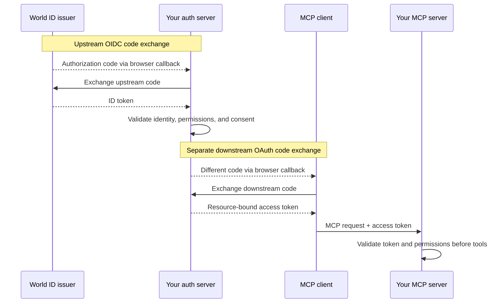

{/* Generated from worldcoin/temporal-apps/apps/idpapi/mcp/guides/mcp-authorization.md. Edit the source Markdown, then run scripts/sync-world-id-auth.mjs. */}

First [configure your auth server](/agent-pass/connect-your-backend#configure-your-auth-server).
It authenticates the user with World ID over OIDC, maps `(iss, sub)` to your
application's account, and issues OAuth access tokens for your MCP server.
The MCP client connects the agent to your server and presents those tokens when
calling its tools.

## Browser authorization {#browser-authorization}

Browser authorization uses two code exchanges:

- **World IdP → your auth server:** World IdP redirects the user's browser
  to your auth server's callback with a code. Your auth server exchanges it for
  an ID token and validates the result.
- **Your auth server → the MCP client:** after checking permissions and required
  consent, your auth server redirects the browser to the MCP client's callback
  with a different code. The client exchanges it for an access token for your
  MCP server.

Keep the two code exchanges' state, PKCE verifiers, callbacks, and codes separate.
Bind both exchanges to the same pending login. Use existing OAuth/MCP components
for client registration, redirect validation, S256 PKCE, resource binding, and
consent.

## Protect your MCP server {#protect-your-mcp-server}

Publish protected-resource metadata identifying your own auth server, and
challenge requests without a valid access token. The MCP client uses that
metadata to start authorization in the user's browser. Validate each access
token's issuer, audience, expiry, permissions, and revocation policy.
Require access tokens issued for your MCP server's resource, and test rejection
of tokens intended for other resources.

`https://auth.world.org/mcp` issues tokens exclusively for the World ID user and developer MCP
resources and rejects any other `resource`.

## Device authentication {#device-authentication}

If your authorization server supports World ID device authentication, use the
[Device Authorization Grant](/agent-pass/connect-your-backend#sign-in-a-headless-agent-device-flow)
for that upstream step. Your authorization server validates the returned ID
token and issues its own access token for your MCP resource through a downstream authorization flow
that the MCP client supports. Confirm support for that downstream flow in both
your authorization server and MCP client.

For authentication freshness at tool execution, follow
[Step-up authentication](/agent-pass/step-up#challenge-an-agent-or-api-client-rfc-9470).
For ID-JAG-based access, see [Cross-App Access (XAA)](/agent-pass/xaa).

Reference: [MCP authorization](https://modelcontextprotocol.io/specification/2025-11-25/basic/authorization).
