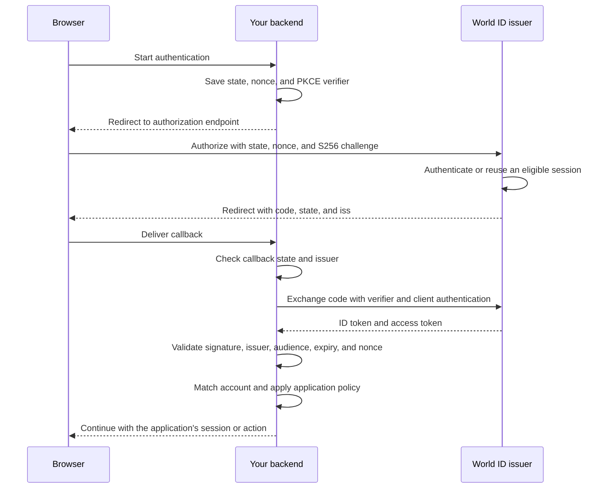

The browser carries redirects. Your backend keeps credentials and the PKCE
verifier private, exchanges the code, and validates the result.

For step-up, also check authentication freshness and assurance before allowing
the protected action. The ID token's claims become usable only after validation.
