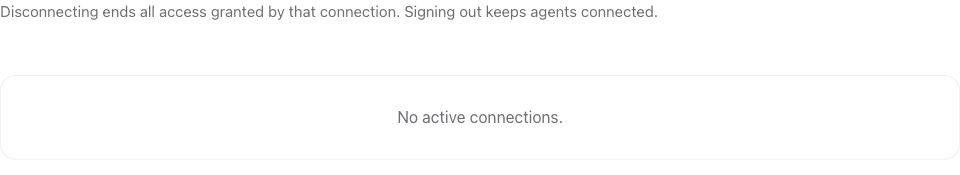

### Manage developer connections

Open [Agents](https://auth.world.org/portal/mcp/connections) to review or revoke
developer-tool connections. Signing out of the portal does not revoke them.

*This is the empty state before a developer tool is connected. World ID user connections are managed separately.*
