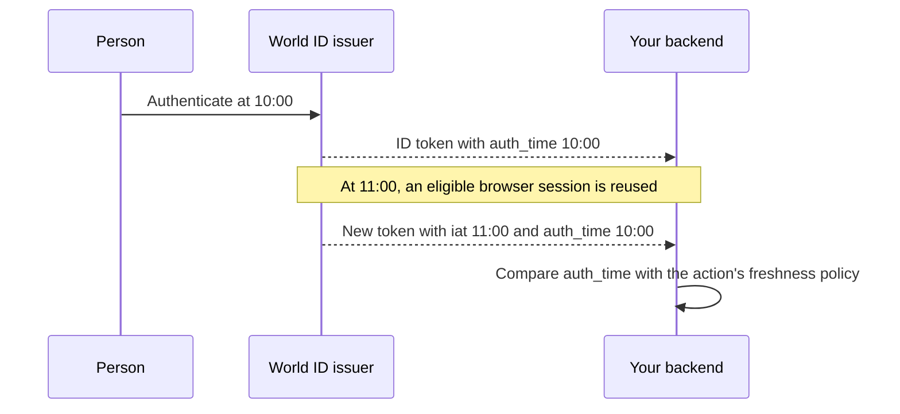

A new token can describe an older authentication. Check `auth_time` when deciding
whether authentication is recent enough for an action.

| Policy or result | What your application checks |
| --- | --- |
| Authentication at 10:00, new token at 11:00 | Authentication is one hour old. The new `iat` does not make it fresh. |
| Maximum age of 300 seconds | Reject that one-hour-old authentication for this action. Check age again when executing the action. |
| `max_age=0` for a browser attempt | Require authentication belonging to the new attempt. Bind it to the attempt and enforce a bounded lifetime; its age need not stay literally zero during the browser round trip. |

Freshness is one check. Also validate the token, match the required account, check
`acr` and `amr` against your policy, and enforce application permissions.
