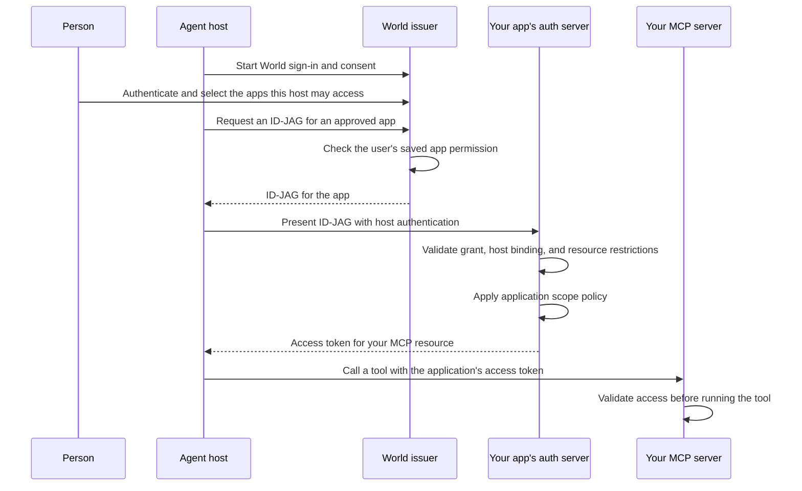

Keep exchange, refresh, and credentials in the host's authentication layer,
outside model messages and tool results. Revoking World app permission stops new
ID-JAGs; your authorization server controls existing access tokens' expiry and
revocation.
