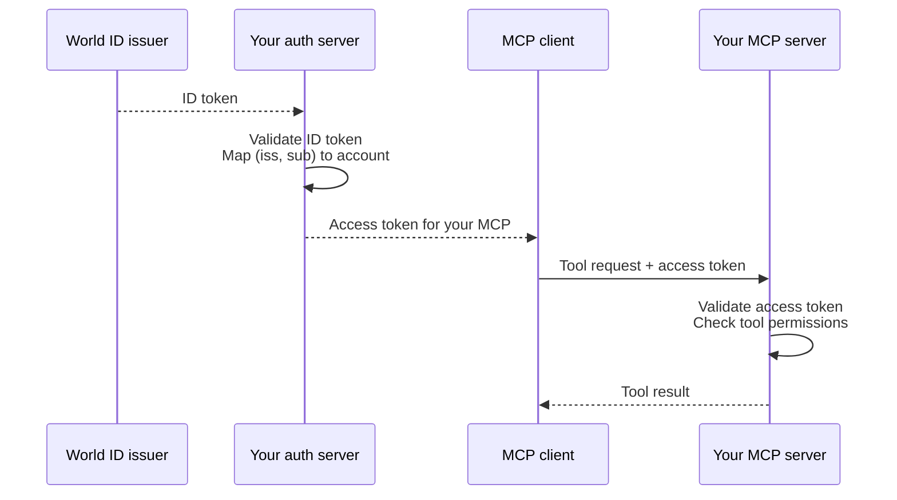

Use the World ID issuer as an upstream OpenID Connect provider when your
application already has an auth server, such as a login backend or OAuth
authorization server. Your auth server is the confidential OIDC client
registered with the World ID issuer. The issuer verifies the person's World ID proof;
your auth server controls your application's sessions, API tokens, permissions,
and consent.

This integration uses the World ID issuer's OIDC endpoints. The issuer does not
configure your auth server, host its downstream OAuth endpoints, or implement
OpenID Federation trust-chain discovery. Verify that your auth server meets the
requirements below before selecting a generic “custom OIDC” connector.

## Configure your auth server {#configure-your-auth-server}

1. **[Register your auth server](/world-id-auth/app-registration)** in the
   developer portal. Use the auth server's callback URL. Your application's
   homepage or an MCP client's callback cannot substitute for it. Choose the
   authentication method your auth server supports and keep its credentials
   there.
2. **Set the issuer** to `https://auth.world.org` and the discovery URL to
   `https://auth.world.org/.well-known/openid-configuration`. Use its authorization endpoint,
   token endpoint, and JWKS URI. Do not select the `/mcp` OAuth issuer for
   federation.
3. **Match the [OIDC settings](/world-id-auth/connect-your-backend#configure-your-oidc-library):**
   authorization code, query response mode, `scope=openid` (optionally adding `email`), fresh `state`
   and `nonce`, and S256 PKCE, including for confidential clients. Disable
   connector defaults that add `profile` or `offline_access`.
4. **Validate the ID token** as described in
   [Validate the ID token](/world-id-auth/connect-your-backend#validate-the-id-token).
5. **Read identity from the validated ID token.** Map `(iss, sub)` to your
   application's account. Preserve validated `auth_time`, `acr`, and `amr` if you
   will enforce step-up. [UserInfo and inbox email claims](/world-id-auth/id-tokens-and-identity)
   are supported, but email is absent for accounts without an enabled inbox.
   Configure your connector to handle that absence.
6. **Issue your own credentials.** Issue your application session or
   resource-bound access token after your own authorization checks. The World ID
   issuer does not issue an OIDC refresh token for authentication with `openid`.
   Your auth server may maintain its own session and refresh policy; renewals
   under that policy do not refresh World ID authentication.

See [Client authentication](/world-id-auth/connect-your-backend#client-authentication)
for the credential formats. Do not assume every library's default OIDC
configuration satisfies this contract.

Follow [Store and match sub](/world-id-auth/id-tokens-and-identity#store-and-match-sub)
for account linking and subject matching. Multiple applications using one auth
server may share the subject issued by the World ID issuer. Configure how your
auth server separates its downstream tenants and users.

Before migrating an auth server or callback domain, follow
[Manage credentials and callbacks](/world-id-auth/app-registration#manage-credentials-and-callbacks).

## Connect the World ID issuer to your MCP server {#connect-the-world-id-issuer-to-your-mcp-server}

Connect the World ID issuer to the auth server used by your MCP server. Your auth
server validates the issuer's ID token and maps `(iss, sub)` to your application's
account. This lets you associate MCP activity with the same account across
sessions. Your auth server issues access tokens, and your MCP server controls
access to its tools. The MCP client is the software connecting the agent to your
server.

The diagram shows token handoffs and validation. Browser redirects and
code-exchange requests are omitted.

Browser authorization uses two code exchanges:

- **World ID issuer → your auth server:** the issuer redirects the user's browser
  to your auth server's callback with a code. Your auth server exchanges it for
  an ID token and validates the result.
- **Your auth server → the MCP client:** after checking permissions and required
  consent, your auth server redirects the browser to the MCP client's callback
  with a different code. The client exchanges it for an access token for your
  MCP server.

Your MCP server publishes protected-resource metadata identifying your auth
server and challenges requests without a valid access token. The MCP client uses
that metadata to start authorization in the user's browser. For tool calls, your
MCP server validates the access token's issuer, audience, expiry, permissions,
and revocation policy.

Keep the two code exchanges' state, PKCE verifiers, callbacks, and codes separate.
Bind both exchanges to the same pending login. Use existing OAuth/MCP components
for client registration, redirect validation, S256 PKCE, resource binding, and
consent.

Do not advertise `https://auth.world.org/mcp` as your MCP server's auth server: it issues
tokens only for the World ID user and developer MCP resources and rejects any
other `resource`.
It cannot mint access tokens for your service. Passing tokens from the World ID
issuer to your MCP server does not establish an authorized integration.

An agent can alternatively use a backend that supports the OIDC device flow.
The backend obtains and validates an ID token, then issues its own credential for
the agent. Both the agent client and backend must support this flow; ordinary
MCP OAuth clients do not automatically use the OIDC device grant.

## Require recent authentication through your auth server {#require-recent-authentication-through-your-auth-server}

Your auth server may reuse its own session before redirecting to the World ID
issuer. For an operation that needs fresh authentication, make your auth server
start a new upstream OIDC request with `max_age=0` or `prompt=login`. Request an
Orb or Face Auth class explicitly when your policy requires World ID proof. Preserve
the validated result from the issuer and check its freshness when the operation
runs. Follow [Step-up through your auth server](/world-id-auth/step-up#through-your-auth-server)
for each layer's requirements.

## Verify the integration {#verify-the-integration}

Test these cases, inspecting the actual upstream authorization parameters and
validated claims without logging tokens or callback query strings:

- Sign in with and without an enabled inbox, and match UserInfo `sub` to the ID token.
- Reuse an existing session and link an account.
- Reject reauthentication with the wrong account and require step-up when
  authentication is too old.
- If you use MCP, reject a token intended for a different resource.

A browser redirect back to the application is only one part of this test.

Ending the World ID issuer's browser session or revoking its saved consent does
not automatically terminate your auth server's sessions or tokens. Provide your
own sign-out and revocation behavior; there is no advertised OIDC end-session or
back-channel logout endpoint to configure.

Reference: [MCP authorization](https://modelcontextprotocol.io/specification/2025-11-25/basic/authorization).
