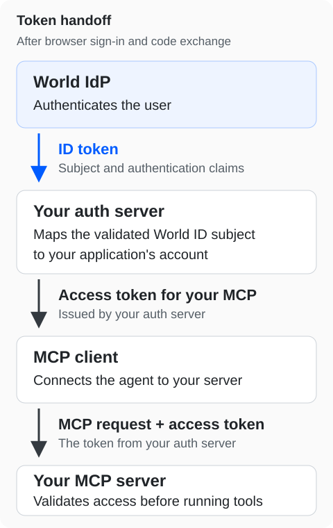

Use this guide when an AI agent calls tools on your Model Context Protocol (MCP) server and you want users to authenticate with World ID first.

Your auth server sits between World IdP and your MCP server:

- Your auth server authenticates the user with World ID over OpenID Connect (OIDC).
- Your auth server maps the ID token's `(iss, sub)` pair to your application's account.
- Your auth server issues OAuth access tokens for your MCP server.
- The MCP client connects the agent to your server and presents those access tokens when it calls your tools.

<Note>
  Before you start, [configure your auth server](https://auth.world.org/docs/guides/oidc#configure-your-auth-server) as an OIDC client of World IdP. Examples use the production issuer `https://auth.world.org`.
</Note>

## Browser authorization



Browser authorization uses two separate code exchanges:

1. **World IdP to your auth server.** World IdP redirects the user's browser to your auth server's callback with a code. Your auth server exchanges the code for an ID token and validates it.
2. **Your auth server to the MCP client.** Your auth server checks permissions and any required consent. It then redirects the browser to the MCP client's callback with a different code. The MCP client exchanges that code for an access token for your MCP server.

Keep the state, PKCE verifiers, callbacks, and codes of the two exchanges separate. Bind both exchanges to the same pending login.

Use existing OAuth and MCP components for client registration, redirect validation, S256 PKCE, resource binding, and consent.

## Protect your MCP server

Publish OAuth protected-resource metadata that identifies your own auth server. The MCP client reads this metadata to start authorization in the user's browser.

Challenge every request that lacks a valid access token with HTTP 401 and a `WWW-Authenticate` header that points to your metadata. This applies to protected tool calls as well as resource reads. Return HTTP 403 when the token is valid but lacks the required scope.

```http
HTTP/1.1 401 Unauthorized
WWW-Authenticate: Bearer resource_metadata="https://mcp.example.com/.well-known/oauth-protected-resource"
```

For each access token, validate:

- Issuer
- Audience
- Expiry
- Permissions
- Your revocation policy

Only accept access tokens issued for your MCP server's resource. Test that your server rejects tokens issued for other resources.

<Info>
  World IdP's own MCP endpoint, `https://auth.world.org/mcp`, issues tokens only for the World ID user and developer MCP resources. It rejects any other `resource` value. To protect your own MCP server, issue tokens from your own auth server.
</Info>

## Device authentication

If your auth server supports World ID device authentication, use the [Device Authorization Grant](https://auth.world.org/docs/guides/oidc#sign-in-a-headless-agent-device-flow) for the upstream step with World IdP.

Your auth server then validates the returned ID token. It issues its own access token for your MCP resource through a downstream authorization flow that the MCP client supports. Confirm that both your auth server and your MCP client support that downstream flow.

## Client ID Metadata Document clients

MCP clients can identify themselves with a Client ID Metadata Document (CIMD). For a CIMD client, the client ID is the exact HTTPS URL of its metadata document. Register and validate CIMD clients with the same OAuth components you use for other clients.

At World IdP, CIMD registration is available only to agent hosts that use [Cross App Access (XAA)](/world-id-auth/xaa#requirements). Requests with only `scope=openid` require a client registered in the developer portal.

## Related guides

- To require fresh authentication when a tool runs, see [Step-up authentication](https://auth.world.org/docs/guides/step-up#challenge-an-agent-or-api-client-rfc-9470).
- To let agent hosts get access to your MCP server with an identity assertion instead of a separate sign-in, see [Cross App Access (XAA)](/world-id-auth/xaa).

Reference: [MCP authorization specification](https://modelcontextprotocol.io/specification/2025-11-25/basic/authorization).
