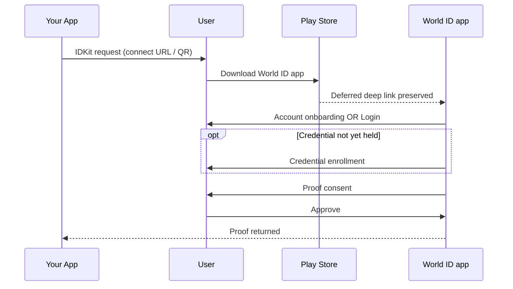
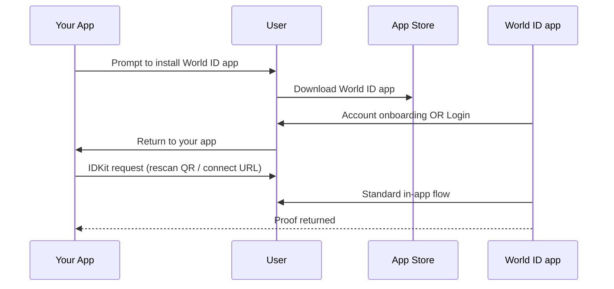
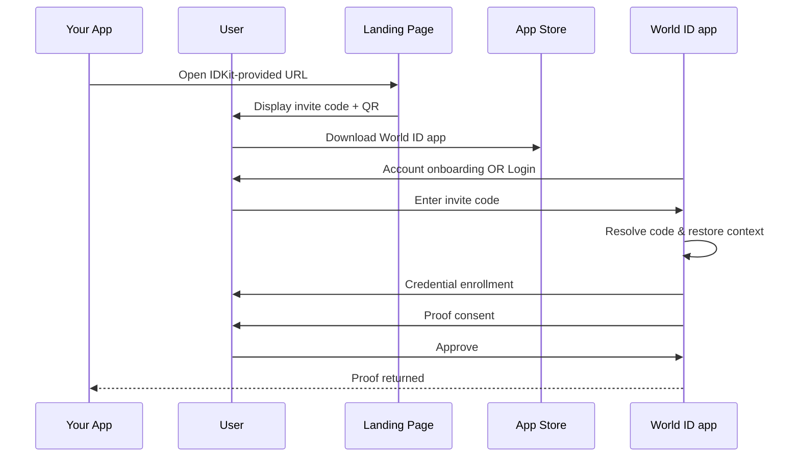

When your app requests a World ID proof, the user lands in one of three flows, determined by whether they have World ID app installed and — if not — whether they already have a World ID.

<Note>
  The integration flow is the same for all three paths, but the user experience differs.
</Note>

| Flow | World ID app installed | Existing account | What happens |
| --- | --- | --- | --- |
| Hot | Yes | — | The World ID app opens, shows a proof consent, and the user approves — typically under 10 seconds. If the user lacks the requested [credential](/world-id/idkit/credentials), the World ID app walks them through enrollment first; your integration sees no difference. |
| Cold | No | No | The user installs the World ID app and completes account onboarding first. The experience differs by platform — see below. |
| Semi-cold | No | Yes | The user installs the World ID app and logs in to their existing account. **Android:** the flow resumes automatically. **iOS:** the user must return to your app and rescan, unless you use invite-code mode — see below. |

## Cold and semi-cold flows

Both flows require an install and behave differently per platform because of how each handles **deferred deep linking** — preserving a link's context through an app store install so the app can act on it at first launch.

### Android

Android supports deferred deep linking through the Play Store. After downloading the World ID app, the user creates an account (cold) or logs in to an existing one (semi-cold), and the World ID app resumes the verification flow automatically.

### iOS

iOS does not support deferred deep linking through the App Store. Install loses the original verification context — for both cold and semi-cold users — so resuming the flow requires additional mechanisms.

#### Default behavior

1. The user downloads the World ID app from the App Store and creates an account or logs in to an existing one.
2. The user returns to your app, which re-triggers the IDKit verification request (e.g., by rescanning the QR code).
3. The World ID app opens and takes the user through the standard in-app flow.
4. The proof consent appears, the user approves, and the proof returns to your app.

#### With invite-code mode

Invite-code mode shows a 6-character code in your app that the user enters into the World ID app. The app treats the code as an entry point to the in-app onboarding flows the user must complete to satisfy your IDKit request, then returns the proof.

<Note>
  Invite-code mode exists because iOS lacks deferred deep linking — Android preserves the context via the Play Store.
</Note>

1. Your app triggers an IDKit invite-code request.
2. Your app opens the URL that IDKit provides. One of three paths follows:
   - **User has World ID app (mobile):** The World ID app launches directly via deep link.
   - **User has World ID app (desktop):** The user scans the QR code with the World ID app.
   - **User needs to install World ID app:** The user installs the World ID app, completes onboarding or logs in, then enters the invite code to resume the request.
3. The World ID app restores the verification context, walks the user through credential enrollment if needed, and presents a proof consent.
4. The user approves and the proof returns to your app.

The 6-character code persists across the App Store install, so once the World ID app is installed and onboarded the user can resume the flow without first returning to your app. This also covers cross-device scenarios (e.g., a desktop browser showing the QR for the user's phone) where deep linking cannot carry context.

**Demo**

  <video className="m-auto" width="700" autoPlay muted loop playsInline>
    <source src="/images/docs/world-id/idkit/invite-code-demo.mp4" type="video/mp4" />
  </video>

**Flow diagram**

**Lifecycle**

- Codes expire after a short TTL (currently fifteen minutes).
- Codes are one-shot — once redeemed, they cannot be reused. Re-running the request returns a fresh code with a fresh TTL.
- After the user redeems the code, your existing poll loop receives the proof exactly as in QR mode.

**Integrate**

Setup is identical to the [standard integration](/world-id/idkit/integrate) — only the request call changes. Choose the appropriate preset in [Configure Credentials](/world-id/idkit/credentials). For code samples and migration guides, see the per-SDK sections: [JavaScript](/world-id/idkit/javascript#invite-code-mode), [React](/world-id/idkit/react#invite-code-mode), [Swift](/world-id/idkit/swift#invite-code-mode).
