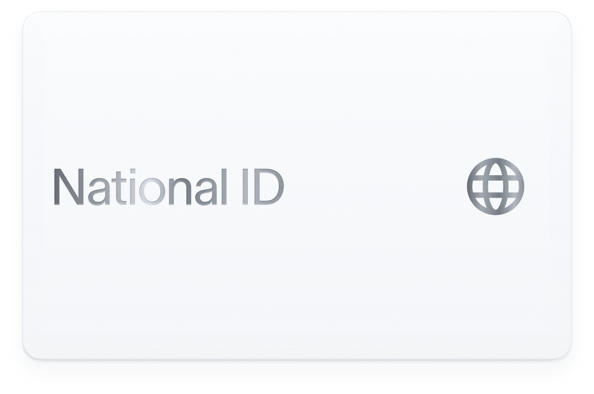

import { Quickstart } from "/snippets/quickstart.jsx";

## World ID

World ID is a privacy-preserving protocol that lets people prove they are real and unique online without sharing personal information.

It gives developers a high-assurance trust layer to stop bots, duplicate accounts, and abuse — while keeping onboarding fast and user data off your servers.

Through credentials like Proof of Human, Proof of Attributes, and Proof of Presence, World ID extends that trust layer with additional proofs without exposing underlying user data.

{/* cspell:ignore worldcoin idkit orblegacy rp_context app_id rp_id selfie-check sybil PoH CAPTCHAs NFC unlinkable nullifier */}

{/*
  Each visual section below is wrapped in <Visibility for="humans"> (rendered on
  the web, excluded from the copy-page/.md export) and paired with a
  <Visibility for="agents"> markdown twin (excluded from the web, rendered in
  the export). Snippet imports are safe ONLY because every usage sits inside a
  for="humans" block: Mintlify inlines a snippet's full source into the export
  when the component appears in exported content, and drops it when all usages
  are hidden (verified on a preview deploy). Keep each twin's copy in sync with
  its visual section when editing.
*/}

<Visibility for="humans">
  <Quickstart
    title="IDKit quickstart"
    description="Add proof of human to your app with one React widget."
    buttonHref="/world-id/idkit/integrate"
    buttonLabel="Open integration guide"
    agentPrompt={{ skillUrl: "world.id/SKILL.md", productName: "World ID" }}
  >
    ```tsx
    import { IDKitRequestWidget } from "@worldcoin/idkit";
    const rpContext = await getRpContext("verify-account");
    <IDKitRequestWidget
      app_id="app_xxxxx"
      action="verify-account"
      rp_context={rpContext}
      // verify proof + nullifier on your backend
      handleVerify={verifyOnBackend}
      onSuccess={unlockFeature}
    />
    ```
  </Quickstart>
</Visibility>

<Visibility for="agents">
  **IDKit quickstart**. Add proof of human to your app with one React widget:

  ```tsx
  import { IDKitRequestWidget } from "@worldcoin/idkit";
  const rpContext = await getRpContext("verify-account");
  <IDKitRequestWidget
    app_id="app_xxxxx"
    action="verify-account"
    rp_context={rpContext}
    // verify proof + nullifier on your backend
    handleVerify={verifyOnBackend}
    onSuccess={unlockFeature}
  />
  ```

  Or tell your coding agent to: `Read world.id/SKILL.md and add World ID to my app` ([world.id/SKILL.md](https://world.id/SKILL.md)).

  Full walkthrough: [integration guide](/world-id/idkit/integrate).
</Visibility>

## Credentials

<Visibility for="humans">
  <div className="not-prose mt-5">
    <div className="grid gap-10 md:grid-cols-3">
      <a href="/world-id/credentials/1" className="block no-underline transition-transform duration-200 hover:-translate-y-0.5">
        
        <h3 className="mt-5 mb-0 text-xl font-medium text-zinc-900 dark:text-zinc-100">Proof of Human</h3>
        <p className="mt-2 text-base text-zinc-800 dark:text-zinc-300">Highest-assurance uniqueness signal from Orb verification. Best for one-person-one-action flows and strong Sybil resistance.</p>
      </a>
      <a href="/world-id/credentials/9303" className="block no-underline transition-transform duration-200 hover:-translate-y-0.5">
        
        <h3 className="mt-5 mb-0 text-xl font-medium text-zinc-900 dark:text-zinc-100">Proof of Attributes</h3>
        <p className="mt-2 text-base text-zinc-800 dark:text-zinc-300">Proves possession of a unique government document through NFC checks. Useful for proof of age and document-backed access flows.</p>
      </a>
      <a href="/world-id/credentials/11" className="block no-underline transition-transform duration-200 hover:-translate-y-0.5">
        
        <h3 className="mt-5 mb-0 text-xl font-medium text-zinc-900 dark:text-zinc-100">Proof of Presence</h3>
        <p className="mt-2 text-base text-zinc-800 dark:text-zinc-300">Low-friction liveness and facial similarity checks from a selfie flow. Best for sign-up and bot defense where speed matters most.</p>
      </a>
    </div>
  </div>
</Visibility>

<Visibility for="agents">
  - [Proof of Human](/world-id/credentials/1) — Highest-assurance uniqueness signal from Orb verification. Best for one-person-one-action flows and strong Sybil resistance.
  - [Proof of Attributes](/world-id/credentials/9303) — Proves possession of a unique government document through NFC checks. Useful for proof of age and document-backed access flows.
  - [Proof of Presence](/world-id/credentials/11) — Low-friction liveness and facial similarity checks from a selfie flow. Best for sign-up and bot defense where speed matters most.
</Visibility>

## IDKit or Agent Pass {#idkit-or-agent-pass}

IDKit gives your application World ID proofs to verify. World IdP gives it
OpenID Connect ID tokens to validate.

### Verify proofs with IDKit

Verify the complete proof on your backend. For a one-use action, reject any
`nullifier` already accepted for that app and action. For returning users, verify
a new proof for the account's saved `session_id` and reject reused
`session_nullifier` values.

### Use OpenID Connect with World IdP

Validate the ID token and map `(iss, sub)` to an account in your application.
Use [step-up authentication](/agent-pass/step-up) when an action requires recent
authentication or a specific authentication method.

With either integration, you manage your application's accounts, sessions, and
permissions. Keep IDKit and World IdP registrations, credentials, and identifiers
separate.

## Choose your integration {#choose-your-integration}

<Visibility for="humans">
  <CardGroup cols={2}>
    <Card
      title="Verify a World ID proof"
      icon="fingerprint"
      href="/world-id/idkit/integrate"
    >
      Verify a proof on your backend and reject reused nullifiers.
    </Card>
    <Card
      title="Verify returning users"
      icon="arrows-rotate"
      href="/world-id/idkit/session-proofs"
    >
      Verify a new proof against the account's saved session ID.
    </Card>
    <Card
      title="Authenticate with World IdP"
      icon="key"
      href="/world-id/agent-pass"
    >
      Add browser sign-in or device authorization from a CLI.
    </Card>
    <Card
      title="Check wallet verification"
      icon="wallet"
      href="/world-chain/reference/address-book"
    >
      Use Address Book to check whether a World Chain wallet is Orb verified.
    </Card>
  </CardGroup>
</Visibility>

<Visibility for="agents">
  - [Verify a World ID proof](/world-id/idkit/integrate). Verify a proof on your backend and reject reused nullifiers.
  - [Verify returning users](/world-id/idkit/session-proofs). Verify a new proof against the account's saved session ID.
  - [Authenticate with World IdP](/world-id/agent-pass). Add browser sign-in or device authorization from a CLI.
  - [Check wallet verification](/world-chain/reference/address-book). Use Address Book to check whether a World Chain wallet is Orb verified.
</Visibility>
